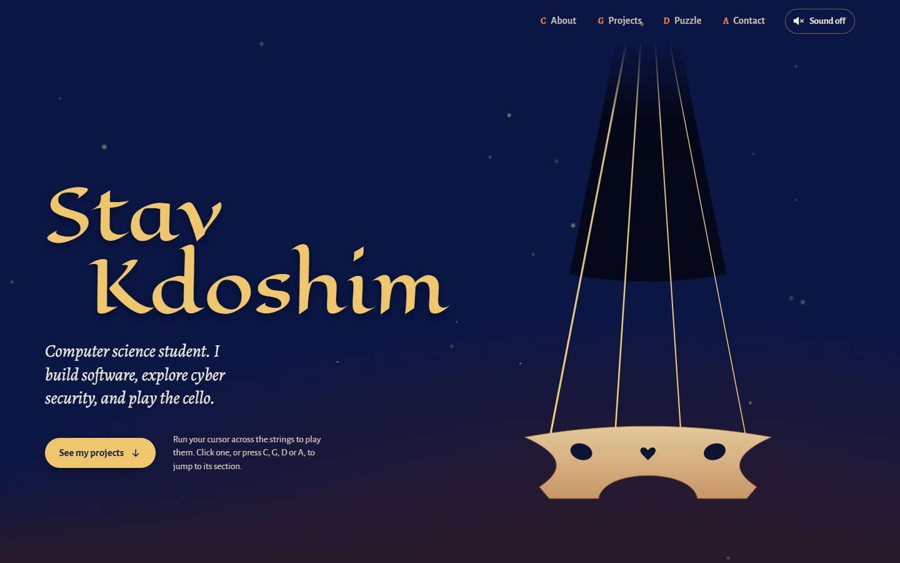
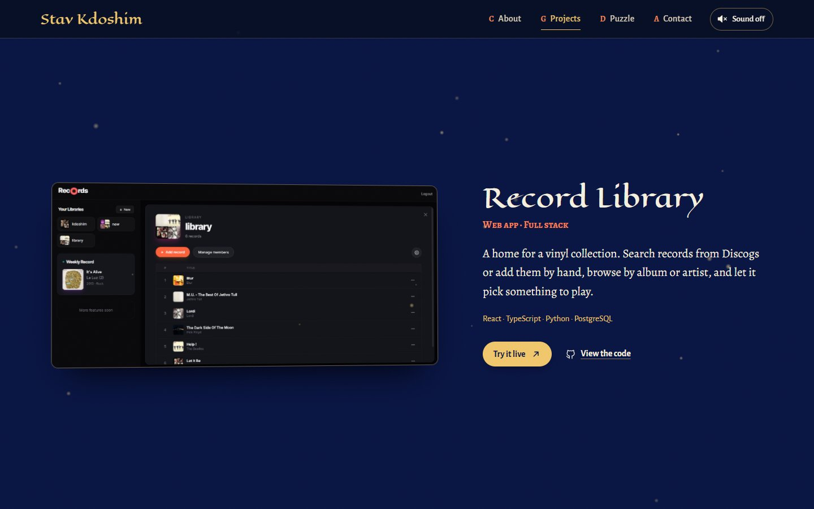

# Stav Kdoshim · Portfolio

My personal portfolio: a computer science student who builds software, explores cyber security and plays the cello. The site is designed like a page from a fantasy book, and the opening screen is a cello you can play.



## What's on the site

- **A playable cello.** Run your cursor (or finger) across the four strings to bow them. Each string plays its real open note (C2, G2, D3, A3), and a small gold note floats up where you touched it. The sound is synthesised live in the browser, with no audio files.
- **The strings are the navigation.** Click a string, or press **C**, **G**, **D** or **A** on the keyboard, to jump to its section: About, Projects, Puzzle or Contact.
- **Six projects** from my GitHub, each with a screenshot or a "how it works" diagram and links to the code and live demos.
- **A cipher puzzle.** An Alberti cipher disc (a real device from 1467) hides a message. Drag the ring or use the **←** **→** keys to decode it.
- **Smooth scrolling.** Sections blend into each other, and the page settles gently on each section and project as you scroll.



## Projects featured

| Project | What it is |
|---|---|
| [Quantum-Ready TLS Proxy](https://github.com/stavkdo/tls-proxy-server) | A proxy that checks whether each connection is protected against future quantum computers |
| [Malware Detector](https://github.com/stavkdo/malware-detector) | A machine-learning model that predicts whether a Windows program is malware |
| [Password Defence Lab](https://github.com/stavkdo/introduction-to-cybersecurity) | Research on how well login protections hold up against real attacks |
| [Record Library](https://github.com/stavkdo/record-library) | A web app for managing and sharing vinyl collections ([live](https://record-library.vercel.app)) |
| [Job Application Tracker](https://github.com/stavkdo/job-application-tracker) | Reads job emails with Gemini AI and keeps a Google Sheet up to date |
| [Puzzle Games](https://github.com/stavkdo/puzzle-games) | Two logic puzzles built from scratch ([live](https://zebra-puzzle.vercel.app)) |

## Built with

- [Astro](https://astro.build): a fast, static site with no framework sent to the browser
- TypeScript, HTML and CSS
- The Web Audio API for the cello sound
- SVG for the cello, the strings, the diagrams and the cipher wheel
- Fonts: [Eagle Lake](https://fonts.google.com/specimen/Eagle+Lake) for headings and [Alegreya](https://fonts.google.com/specimen/Alegreya) for text
- Designed with the help of [Impeccable](https://github.com/pbakaus/impeccable), a design skill for AI coding agents

## Run it locally

You need [Node.js](https://nodejs.org) 20 or newer.

```bash
npm install      # install dependencies (once)
npm run dev      # start the site at http://localhost:4321
npm run build    # build the finished site into dist/
npm run preview  # preview the built site
```

## Where things are

```
src/
├── data/content.ts      All the text: name, projects, links, section names
├── components/          One file per section (Hero, About, Projects, Puzzle, Contact, TopBar)
├── scripts/
│   ├── audio.ts         The cello sound, with every setting at the top
│   ├── strings.ts       Drawing and playing the strings, and keyboard shortcuts
│   ├── cipher.ts        The cipher wheel
│   └── ...              Navigation, scroll reveals, the drifting specks of light
├── styles/global.css    All styling: colours, fonts, layout, scroll behaviour
└── pages/index.astro    Puts the sections together
public/projects/         Project screenshots
```

## Making changes

- **Text and projects:** edit [`src/data/content.ts`](src/data/content.ts). Adding a project means adding one entry to the `projects` list.
- **The About section:** [`src/components/About.astro`](src/components/About.astro).
- **The cello's sound:** the `CELLO` block at the top of [`src/scripts/audio.ts`](src/scripts/audio.ts). Each setting (warmth, brightness, vibrato, echo and more) has a short note explaining it.
- **Colours and fonts:** the variables at the top of [`src/styles/global.css`](src/styles/global.css).
- **How firmly the page settles while scrolling:** search for `scroll-snap-type` in `global.css` (`mandatory` is firm, `proximity` is gentle).

## Contact

- Email: [stavkd04@gmail.com](mailto:stavkd04@gmail.com)
- GitHub: [stavkdo](https://github.com/stavkdo)
- LinkedIn: [Stav Kdoshim](https://www.linkedin.com/in/stav-kdoshim/)
